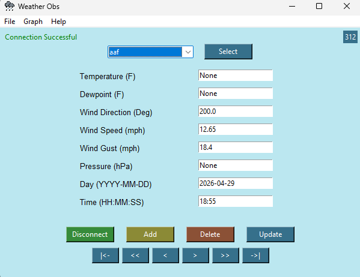
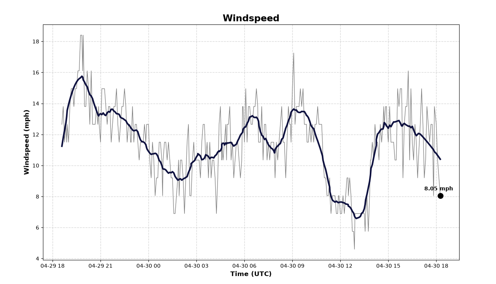
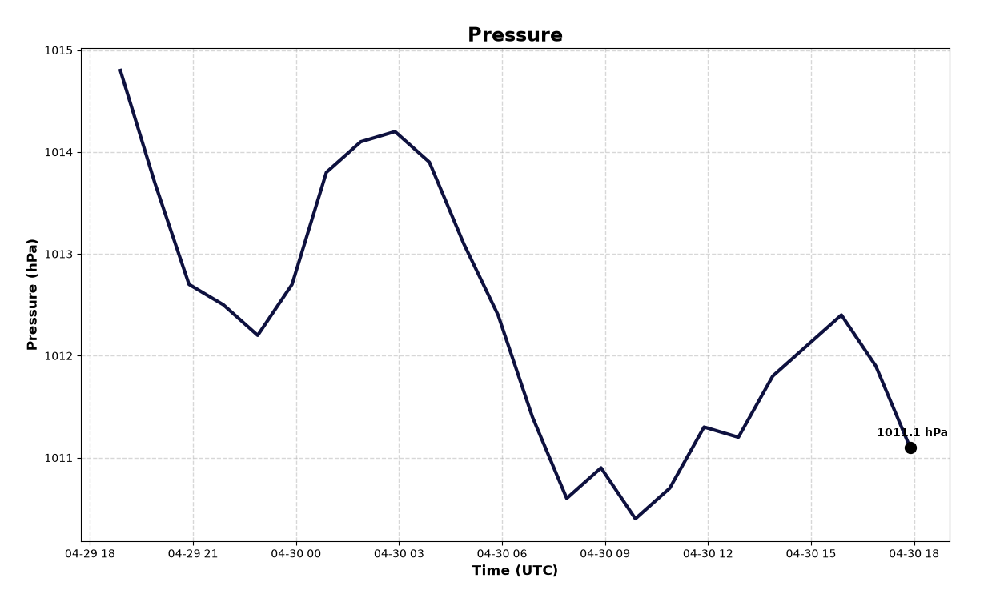
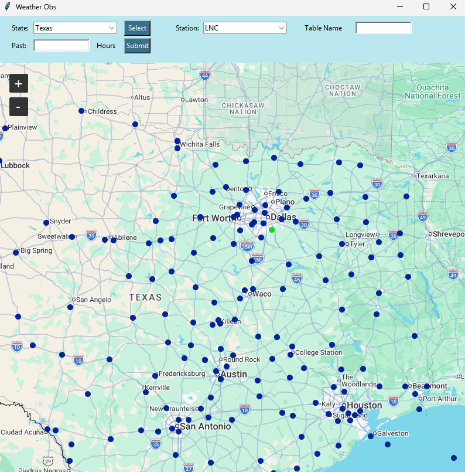

# WODS

Weather Observations Databse in SQLite (WODS) is a python application that reads GeoJSON data from weather station sites across the CONUS
and converts them into SQLite databases. This was created in the Spring of 2026 as the final project for my computer science course.



## Features

- Record and manage observations
- Store data persistently using SQLite
- Graph temperature vs dewpoint
- Graph windspeed 
- Graph pressure
- Retrieve live observation data

## Screenshots








## Installation

### Requirements
- Python 3.11 or later
- Matplotlib, SciPy, NumPy, pandas, tkintermapview

### Setup

Clone the repository:

```bash
git clone https://github.com/lhuang6/WODS.git
cd wods
```

Create and activate a virtual environment, then install:

```bash
python -m venv .venv
python -m pip install -e .
```

### Run

```bash
python -m observations
```